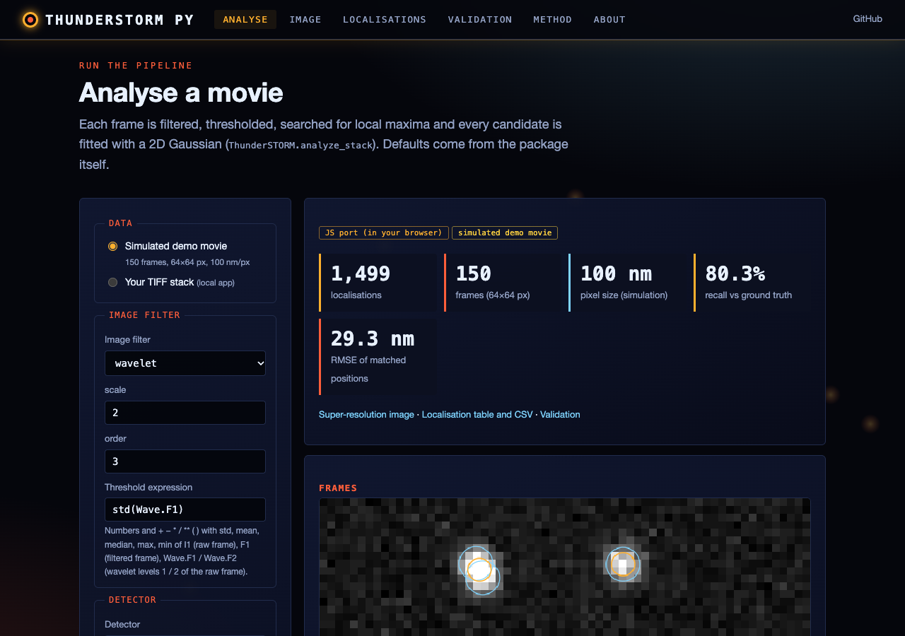
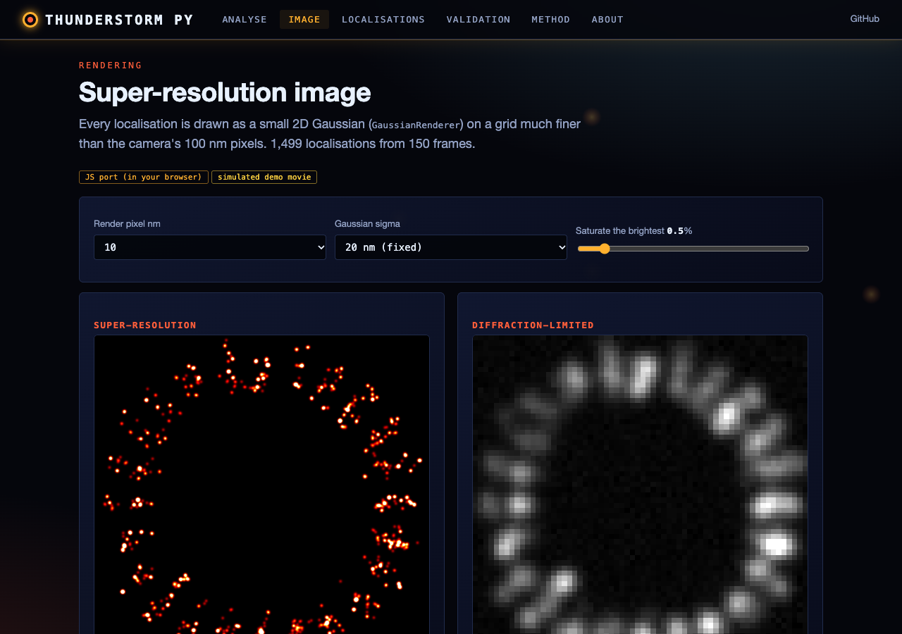
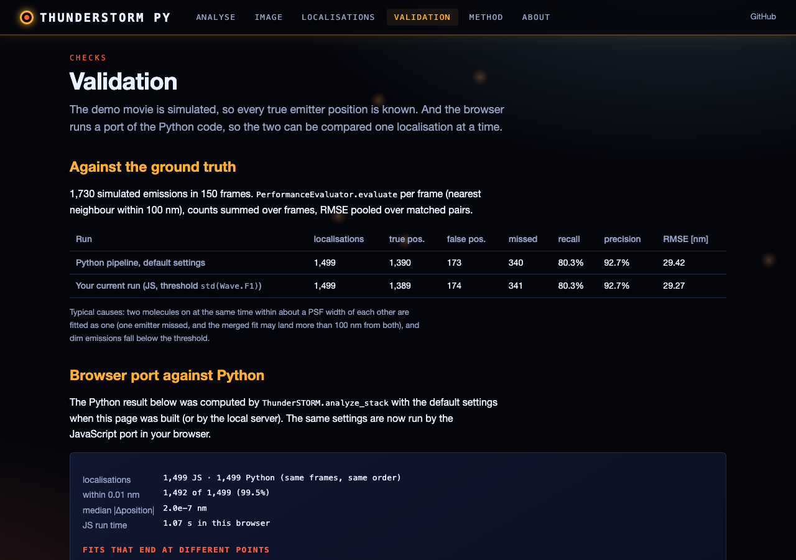

# ThunderSTORM Python

A Python implementation of thunderSTORM for Single Molecule Localization Microscopy (SMLM) data analysis.

## Overview

This package provides a complete Python clone of the popular [thunderSTORM](https://github.com/zitmen/thunderstorm) ImageJ plugin, implementing all major features for PALM/STORM/SMLM analysis.

**Reference:** Ovesný, M., Křížek, P., Borkovec, J., Švindrych, Z., & Hagen, G. M. (2014). ThunderSTORM: a comprehensive ImageJ plugin for PALM and STORM data analysis and super-resolution imaging. *Bioinformatics*, 30(16), 2389-2390.

## Features

### Core Analysis Pipeline
- **Image Filtering**: Wavelet, Gaussian, DoG, LoG, median, and more
- **Molecule Detection**: Local maxima, non-maximum suppression, centroid
- **PSF Fitting**: 
  - Gaussian (2D and 3D astigmatism)
  - Least Squares (LSQ)
  - Weighted Least Squares (WLSQ)
  - Maximum Likelihood Estimation (MLE)
  - Radial Symmetry (fast, non-iterative)
  - Centroid

### Post-Processing
- **Drift Correction**: Cross-correlation and fiducial marker tracking
- **Molecule Merging**: Handle blinking with configurable frame gaps
- **Filtering**: Quality-based filtering (intensity, uncertainty, sigma)
- **Local Density Filtering**: Remove isolated localizations
- **Duplicate Removal**: Clean up multi-emitter fitting results

### Visualization
- **Gaussian Rendering**: High-quality super-resolution images
- **Histogram**: Fast rendering with optional jittering
- **Average Shifted Histogram (ASH)**: Fast alternative to Gaussian rendering
- **3D Rendering**: Color-coded Z-slices for 3D data

### Simulation
- **Synthetic Data Generation**: Create test datasets with known ground truth
- **Blinking Simulation**: Realistic fluorophore dynamics
- **Performance Evaluation**: Precision/recall, F1 score, RMSE analysis
- **Test Patterns**: Siemens star, grids, circles for resolution testing

## Installation

```bash
# Clone repository
git clone https://github.com/gddickinson/thunderstorm_python.git
cd thunderstorm_python

# Install dependencies (tifffile is needed to load .tif stacks)
pip install -r requirements.txt tifffile

# Install package
pip install -e .
```

## Quick Start

```python
import numpy as np
from thunderstorm_python import ThunderSTORM
from thunderstorm_python.utils import load_image_stack

# Load your SMLM data
images, metadata = load_image_stack('your_data.tif')

# Create analysis pipeline with default settings
pipeline = ThunderSTORM(
    filter_type='wavelet',
    detector_type='local_maximum',
    fitter_type='gaussian_lsq',
    threshold_expression='std(Wave.F1)',
    pixel_size=100.0  # nm/pixel
)

# Analyze all frames
localizations = pipeline.analyze_stack(images)

# Apply drift correction
localizations = pipeline.apply_drift_correction(method='cross_correlation')

# Filter by quality
localizations = pipeline.filter_localizations(
    min_intensity=300,
    max_uncertainty=50
)

# Render super-resolution image
sr_image = pipeline.render(
    renderer_type='gaussian',
    pixel_size=10  # nm
)

# Save results
pipeline.save('localizations.csv')

# Get statistics
stats = pipeline.get_statistics()
print(f"Found {stats['n_localizations']} molecules")
print(f"Mean uncertainty: {stats['mean_uncertainty']:.2f} nm")
```

## Coordinates and units

- **x, y are in nm with a pixel-centre origin**: the centre of camera pixel (row 0, column 0) is (0, 0) nm, so pixel
  (row r, column c) is centred at (c x pixel_size, r x pixel_size). x runs along columns, y along rows. This matches
  the simulator's ground truth. ImageJ and thunderSTORM put the origin at the pixel *corner*, i.e. their x = ours +
  pixel_size / 2; `thunderstorm_format.save_thunderstorm_csv` converts (and writes 1-based frames).
- `pixel_size` (nm per camera pixel) must be set for your camera; the default 100 nm is only a placeholder.
- `sigma_x`, `sigma_y` are in camera pixels; `uncertainty` is in nm (Mortensen et al. 2010, `uncertainty.py`).
- Candidates whose fit fails are not localizations: `pipeline.get_rejected()` lists them with the reason.
- `pipeline.save()` writes the package's own columns (`x [nm]` etc., same origin); use
  `thunderstorm_format.save_thunderstorm_csv(locs, path, pixel_size=...)` for thunderSTORM's format.

## Detailed Examples

### Example 1: Basic Analysis

```python
from thunderstorm_python import quick_analysis
from thunderstorm_python.utils import load_image_stack
import matplotlib.pyplot as plt

# Load data
images, _ = load_image_stack('data.tif')

# Quick analysis with defaults
localizations, sr_image, pipeline = quick_analysis(images)

# Display results
plt.figure(figsize=(12, 5))
plt.subplot(121)
plt.imshow(images[0], cmap='gray')
plt.title('Raw Image (Frame 0)')

plt.subplot(122)
plt.imshow(sr_image, cmap='hot')
plt.title('Super-Resolution')
plt.tight_layout()
plt.show()

print(f"Detected {len(localizations['x'])} molecules")
```

### Example 2: Custom Analysis Pipeline

```python
from thunderstorm_python import ThunderSTORM

# Create custom pipeline
pipeline = ThunderSTORM(
    # Filtering
    filter_type='wavelet',
    filter_params={'scale': 2, 'order': 3},
    
    # Detection
    detector_type='local_maximum',
    detector_params={'connectivity': '8-neighbourhood'},
    
    # PSF Fitting
    fitter_type='gaussian_mle',  # Use MLE instead of LSQ
    fitter_params={
        'integrated': True,
        'elliptical': True,  # Fit elliptical Gaussian
        'initial_sigma': 1.5
    },
    
    # Threshold
    threshold_expression='2*std(Wave.F1)',  # More stringent
    
    # Camera parameters
    pixel_size=160.0,  # nm
    photons_per_adu=0.45,
    baseline=100.0,
    em_gain=300.0  # EMCCD gain
)

# Analyze
localizations = pipeline.analyze_stack(images, fit_radius=4)

# Post-processing chain
localizations = pipeline.apply_drift_correction(method='cross_correlation')
localizations = pipeline.merge_molecules(max_distance=30, max_frame_gap=2)
localizations = pipeline.filter_localizations(
    min_intensity=500,
    max_intensity=10000,
    max_uncertainty=30
)
localizations = pipeline.filter_by_density(radius=100, min_neighbors=5)

# Save
pipeline.save('results.csv')
```

### Example 3: 3D Analysis (Astigmatism)

```python
# For 3D SMLM using astigmatism
# You need a calibration curve - see thunderSTORM docs for calibration

pipeline = ThunderSTORM(
    filter_type='wavelet',
    detector_type='local_maximum',
    fitter_type='gaussian_lsq',
    fitter_params={
        'elliptical': True,  # Required for 3D
        'initial_sigma': 1.3
    },
    pixel_size=100.0
)

# Analyze
localizations = pipeline.analyze_stack(images_3d)

# The sigma_x and sigma_y can be used to estimate Z position
# based on your calibration curve
```

### Example 4: Data Simulation

```python
from thunderstorm_python.simulation import SMLMSimulator, create_test_pattern
import matplotlib.pyplot as plt

# Create simulator
simulator = SMLMSimulator(
    image_size=(256, 256),
    pixel_size=100.0,  # nm
    psf_sigma=150.0,  # nm
    photons_per_molecule=1000,
    background_photons=10
)

# Create test pattern
pattern = create_test_pattern('siemens_star', size=256)

# Generate movie
movie, ground_truth = simulator.generate_movie(
    n_frames=1000,
    mask=pattern,
    blinking=True
)

# Analyze simulated data
pipeline = ThunderSTORM()
localizations = pipeline.analyze_stack(movie)

# Evaluate performance
from thunderstorm_python.simulation import PerformanceEvaluator

evaluator = PerformanceEvaluator(tolerance=100.0)  # nm

# Compare to ground truth (frame by frame)
for i, gt in enumerate(ground_truth):
    frame_locs = {
        'x': localizations['x'][localizations['frame'] == i],
        'y': localizations['y'][localizations['frame'] == i]
    }
    
    metrics = evaluator.evaluate(frame_locs, gt)
    print(f"Frame {i}: Recall={metrics['recall']:.2f}, "
          f"Precision={metrics['precision']:.2f}, "
          f"RMSE={metrics['rmse']:.1f} nm")
```

### Example 5: Multiple Renderer Comparison

```python
from thunderstorm_python import visualization
import matplotlib.pyplot as plt

# Create different renderers
renderers = {
    'Gaussian': visualization.GaussianRenderer(sigma=20),
    'Histogram': visualization.HistogramRenderer(jittering=False),
    'Jittered Histogram': visualization.HistogramRenderer(jittering=True, n_averages=10),
    'ASH (n=4)': visualization.AverageShiftedHistogram(n_shifts=4),
    'ASH (n=8)': visualization.AverageShiftedHistogram(n_shifts=8)
}

# Render with each method
fig, axes = plt.subplots(2, 3, figsize=(15, 10))
axes = axes.ravel()

for i, (name, renderer) in enumerate(renderers.items()):
    img = renderer.render(localizations, pixel_size=10)
    axes[i].imshow(img, cmap='hot')
    axes[i].set_title(name)
    axes[i].axis('off')

plt.tight_layout()
plt.show()
```

## Web interface

Live site: **https://gddickinson.github.io/thunderstorm_python/** (static; published from `main` by
`.github/workflows/pages.yml`).



| Super-resolution image | Validation |
|---|---|
|  |  |

- **Analyse**: choose the filter, threshold expression, detector, PSF fitter, fit radius and camera settings
  (pixel size in nm, photons/ADU, baseline), run, and step through the frames with every localisation marked.
- **Image**: Gaussian rendering of the localisations at 5-50 nm per pixel beside the diffraction-limited view.
- **Localisations**: sortable table and a CSV export in thunderSTORM's column format
  (`thunderstorm_format.py`: 1-based frames, corner-origin x/y in nm, sigma in nm, photons).
- **Validation**: recall / precision / RMSE against the simulation's ground truth, and the browser port compared
  with the Python pipeline localisation by localisation.
- **Method** and **About**.

The demo data is a small movie **simulated by the package's own `SMLMSimulator`** (64x64 px at 100 nm/px, 150 frames,
molecules on a Siemens-star mask); it is not real data. On the static site the pipeline runs in the browser: a
JavaScript port of the wavelet / Gaussian / DoG filters, threshold expressions, local-maximum and
non-maximum-suppression detectors and the least-squares Gaussian fitter, including a port of MINPACK's
Levenberg-Marquardt (what `scipy.optimize.curve_fit` uses). `web/static/ts_engine.test.mjs` checks it against values
computed by the Python code (`tests/fixtures/engine_cases.json`, regenerated by `scripts/make_engine_fixture.py`).
On the full demo movie 1,497 of 1,499 localisations agree within 0.01 nm (median difference 2e-7 nm); the other 2 are
ill-conditioned fits that stop at different points.

### Run the web app (local, your own TIFFs)

```bash
pip install -r requirements-web.txt
python run_web.py            # http://127.0.0.1:8210
```

The local app runs the Python pipeline for every analysis, with all filters, detectors and fitters, on the demo or
on an uploaded TIFF (2D image or frames x rows x columns). The pixel size is taken from the file's OME / ImageJ
metadata when present (you can override it), otherwise from the value you enter; the result states which was used.
The repository folder must be named `thunderstorm_python` (it is the package). Tests: `python -m pytest -q tests`
and `node web/static/ts_engine.test.mjs`. Static build: `python scripts/build_static.py --out site`.

## Advanced Features

### Custom Threshold Expressions

ThunderSTORM supports mathematical threshold expressions:

```python
# Standard deviation of filtered image
threshold_expression='std(Wave.F1)'

# Multiple of standard deviation
threshold_expression='2*std(Wave.F1)'

# Mean + N standard deviations
threshold_expression='mean(Wave.F1) + 3*std(Wave.F1)'

# Based on raw image
threshold_expression='mean(I1) + 5*std(I1)'

# Fixed value
threshold_expression=100.0
```

### Batch Processing

```python
from pathlib import Path
from thunderstorm_python import ThunderSTORM, utils

# Process multiple files
data_dir = Path('data/')
output_dir = Path('results/')
output_dir.mkdir(exist_ok=True)

pipeline = ThunderSTORM()

for tif_file in data_dir.glob('*.tif'):
    print(f"Processing {tif_file.name}...")
    
    # Load
    images, _ = utils.load_image_stack(tif_file)
    
    # Analyze
    localizations = pipeline.analyze_stack(images)
    
    # Save
    output_file = output_dir / f"{tif_file.stem}_localizations.csv"
    pipeline.save(output_file)
```

### Working with Results

```python
import pandas as pd
import matplotlib.pyplot as plt

# Load results as pandas DataFrame
df = pd.read_csv('localizations.csv')

# Plot localization precision histogram
plt.hist(df['uncertainty'], bins=50)
plt.xlabel('Localization Uncertainty (nm)')
plt.ylabel('Count')
plt.show()

# Plot intensity vs sigma
plt.scatter(df['intensity'], df['sigma_x'], alpha=0.1)
plt.xlabel('Intensity (photons)')
plt.ylabel('PSF Sigma (pixels)')
plt.show()

# Filter and re-save
filtered_df = df[
    (df['uncertainty'] < 30) &
    (df['intensity'] > 500) &
    (df['sigma_x'] > 0.8) &
    (df['sigma_x'] < 2.0)
]
filtered_df.to_csv('filtered_localizations.csv', index=False)
```

## Performance Tips

1. **Use appropriate filtering**: Wavelet filter works best for most data
2. **Tune threshold**: Start with `std(Wave.F1)` and adjust
3. **PSF sigma**: Estimate from your data, typically 1.0-1.6 pixels
4. **Fitting radius**: 3-5 pixels is usually sufficient
5. **MLE vs LSQ**: MLE is more accurate but slower
6. **Radial symmetry**: Very fast but less accurate than Gaussian fitting

## Contributing

Contributions welcome! Please submit issues and pull requests on GitHub.

## License

MIT License (see `LICENSE`). This is an independent Python reimplementation; the original
thunderSTORM ImageJ plugin is distributed under its own (GPL-3.0) licence.

## Citation

If you use this software, please cite the original thunderSTORM paper:

```
Ovesný, M., Křížek, P., Borkovec, J., Švindrych, Z., & Hagen, G. M. (2014).
ThunderSTORM: a comprehensive ImageJ plugin for PALM and STORM data analysis 
and super-resolution imaging. Bioinformatics, 30(16), 2389-2390.
```

## Acknowledgments

This Python implementation is based on the excellent thunderSTORM ImageJ plugin by Martin Ovesný et al. All credit for the algorithms and methodology goes to the original authors.

## Contact

For questions or issues, please open an issue on GitHub.
